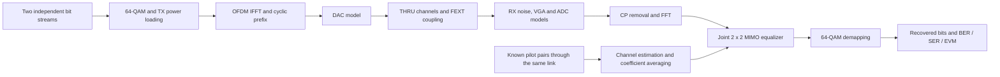
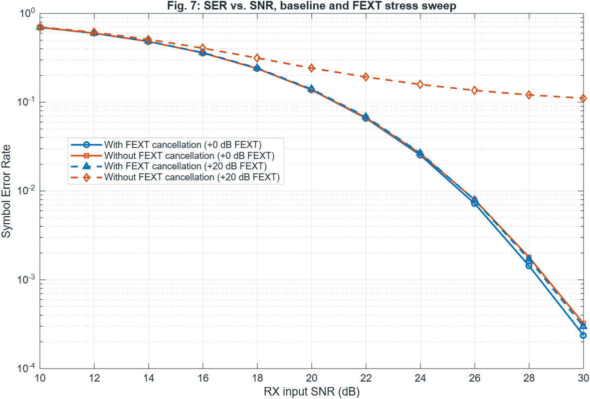
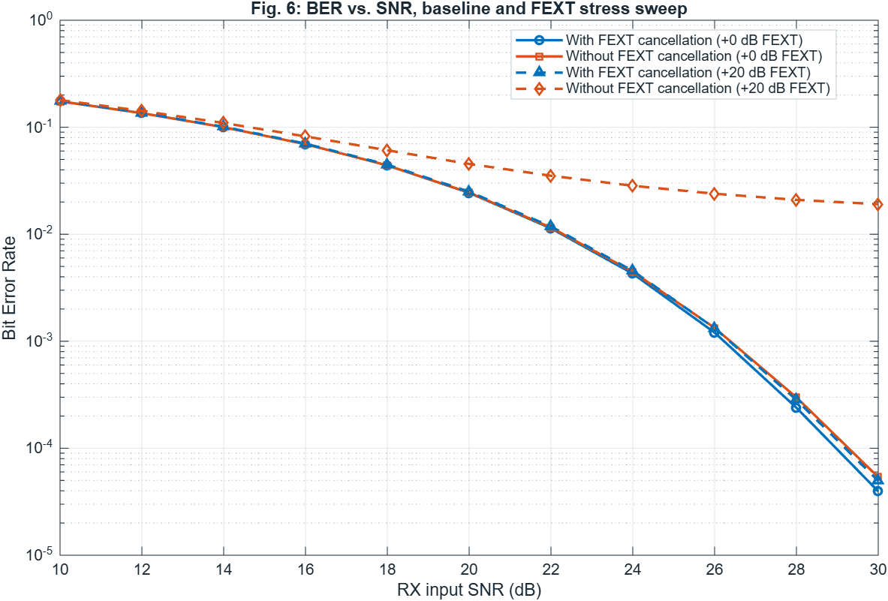

# 224 Gb/s ADC-Based MIMO-OFDM Wireline Receiver

**MATLAB reference model · 224 Gb/s per lane · 64-QAM · 2×2 MIMO · FEXT cancellation**

A graduation project at **Cairo University, Faculty of Engineering**, studying how a two-lane receiver can recover high-speed wireline data in the presence of channel loss, far-end crosstalk, and converter impairments.

The current software implements and evaluates the communication system in MATLAB. It provides the algorithmic reference for the **22 nm mixed-signal ASIC design direction** presented in our second meeting with **Professor Mohamed Radwan**: an ADC/AFE interface feeding a custom digital processor for OFDM reception and joint lane equalization.

> **Current deliverable:** a working MATLAB behavioral model with Tests 1–6, imported channel data, and BER/SER/EVM analysis.
>
> **Implementation objective:** a fabrication-ready receiver ASIC design package, subject to PDK access and analog/digital feasibility. Silicon fabrication is outside the proposed project scope.

[Run the simulation](#run-the-simulation) · [Receiver architecture](#receiver-architecture) · [Tests](#what-the-six-tests-demonstrate) · [Results](#reading-the-results) · [Project files](#project-files)

## Why this project?

At high data rates, the intended signal is attenuated by the interconnect while a neighboring transmitter leaks energy into the receiver. That unwanted coupling is **far-end crosstalk (FEXT)**.

A conventional per-lane equalizer compensates the main channel but leaves the neighboring lane's interference. A **MIMO receiver processes both received lanes together**, using estimated main-path and coupling responses to separate their transmitted signals.

Our model investigates three questions:

1. Can the QAM/OFDM signal chain and channel-estimation equations recover the transmitted data correctly?
2. How much does joint equalization improve recovery when FEXT is present?
3. What changes when noise, sampling jitter, clipping, quantization, and imperfect channel estimates are included?

The reference architecture is G. Kim's *Far-End Crosstalk Cancellation With MIMO OFDM for >200 Gb/s ADC-Based Serial Links*, IEEE TCAS-II, 2023.

## Run the simulation

**Requirement:** base MATLAB. The retained full run was verified using **MATLAB R2026b**. Custom QAM and impairment functions are included, so no Communications Toolbox, Python installation, or channel download is required.

Open this repository folder as MATLAB's **Current Folder**, then run:

```matlab
main_224
```

That single command adds the source folders, loads the included channel files, runs Tests 1–6 and the FEXT/SNR sweeps, exports the figures, and saves the simulation data.

| Output | Location |
|---|---|
| Figures | `results/224G/figures/` |
| Configuration, metrics, and received/transmitted symbols | `results/224G/results_224G.mat` |
| Summary and elapsed time | MATLAB Command Window |

The latest verified full run took approximately **140 seconds** on the development computer. Runtime depends on the machine. The sweep displays one waiting message while it works. Rerunning replaces the generated outputs at the same paths.

## Receiver architecture

The simulation generates two independent transmitted lanes and follows them through the complete modeled link:



**THRU** is the intended transmitter-to-receiver path. **FEXT** is the leakage from the neighboring lane into the far-end receiver. Training pilots pass through the same link model as data; the resulting coefficients describe both main paths and both coupling paths.

The proposed ASIC receiver begins at the analog input and implements the AFE/ADC, sample handling, FFT, channel estimation, MIMO equalization, and demapping. The MATLAB transmitter supplies test stimuli for that receiver study.

## What the six tests demonstrate

The tests progress from an isolated modulation check to the full impaired link.

| Test | Channel and FEXT | Equalizer knowledge | Noise and converter effects | What it demonstrates |
|---|---|---|---|---|
| **T1 — QAM reference** | No physical channel; direct symbol-level Gaussian noise | No channel estimator | AWGN swept over 10–30 dB Es/N0 | Measured 64-QAM SER versus theory |
| **T2 — Main path** | Main channel; FEXT off | Exact known channel; single-lane equalization | Off | Main-path recovery and residual OFDM distortion |
| **T3 — Uncancelled FEXT** | Main channel + FEXT | Exact known channel; per-lane equalization | Off | Distortion introduced by uncancelled coupling |
| **T4 — Cancelled FEXT** | Same physical conditions as T3 | Exact known channel; joint MIMO equalization | Off | Cancellation under controlled conditions |
| **T5 — Minimal training** | Main channel + FEXT | Pilot estimation, **L = 1**; cancellation on | On | Sensitivity to a noisy channel estimate |
| **T6 — Full baseline** | Main channel + FEXT | Pilot estimation, **L = 200**; cancellation on | On | Recovery with averaged coefficients and modeled impairments |

**L** is the number of training cycles used for coefficient averaging. Hardware effects include DAC/ADC clipping and quantization, independently seeded TX/RX sampling jitter, and receiver random noise.

### FEXT-strength and SNR sweeps

The existing BER and SER figures compare **with and without cancellation** at two coupling strengths:

| Case | FEXT change | Meaning |
|---|---:|---|
| Original channel | **0 dB** | Imported coupling response |
| Stronger-FEXT stress test | **+20 dB** | Coupling amplitude multiplied by **10** |

At each point, both equalization modes use the same received data and channel estimate. The coupling gain is applied consistently to training and data. The stress case changes the imported coupling artificially; it is not a second measured channel.

Both strengths are overlaid in `fig06_ber_vs_snr.png` and `fig07_ser_vs_snr.png`. The default RX-input SNR sweep is **10:2:30 dB**.

## Reading the results

### What stronger FEXT reveals



With the original weak coupling, noise and converter effects limit the visible SER benefit. Increasing FEXT exposes a much larger penalty without cancellation, while joint equalization recovers much of the lost performance. The plot shows why cancellation should be assessed against both coupling strength and noise level.

### Bit error rate across SNR

The BER plot compares recovered bits under the same four conditions: original and stronger FEXT, each with cancellation enabled or disabled. Lower BER means fewer incorrect recovered bits.



### Three complementary measurements

| Metric | What it measures | How to interpret it |
|---|---|---|
| **BER — bit error rate** | Wrong recovered bits / transmitted bits | End-to-end bit recovery |
| **SER — symbol error rate** | Wrong QAM decisions / transmitted QAM symbols | Whether distortion crosses decision boundaries |
| **EVM — error vector magnitude** | RMS symbol error normalized to RMS transmitted-symbol amplitude | Residual distortion before hard decisions; lower is better |

Tests 2–4 can report zero observed BER/SER while their EVM values differ. Received points can move within the correct constellation decision region. In Test 2, CP8 also leaves a small amount of interference from the longer imported impulse response, even with added noise disabled.

### Current baseline and paper comparison

The latest verified default **T6 run**, using L200 and 2,000 data OFDM symbols per lane, produced approximately:

| Metric | Current default T6 | Paper reference |
|---|---:|---:|
| SER with cancellation | **7.39 × 10⁻⁵** | 1.4 × 10⁻⁵ |
| SER without cancellation, on the same received data | **1.09 × 10⁻⁴** | 4 × 10⁻¹ |
| Pre-FEC BER with cancellation | **1.23 × 10⁻⁵** | 2.4 × 10⁻⁶ |

These are finite-run simulation results. The saved `.mat` file contains the exact values and counts. The presentation's earlier three-seed confirmation used a different averaging window and run length; its pooled numbers are separate evidence from this default run.

The imported channel differs from the paper's illustrated coupling. Also, the fixed-noise baseline retains **1.8 mV RMS added after VGA**, while the paper describes RX-input noise. During the SNR sweeps, noise is instead added **before VGA** and its amplitude is adjusted to the requested SNR. These differences matter when comparing error rates. See [model assumptions](docs/assumptions.md) and [validation](docs/validation.md).

## Baseline configuration

All active settings are in [`config/config_224G.m`](config/config_224G.m).

| Parameter | Default |
|---|---|
| Data-rate designation | 224 Gb/s **per lane** |
| Modeled lanes | 2, with symmetric THRU/FEXT paths |
| Modulation | Gray-coded 64-QAM, 6 bits per symbol |
| FFT / cyclic prefix | 1024 points / 8 samples |
| Data subcarriers | 511 positive-frequency tones per lane |
| Sampling rate / occupied bandwidth | 75.25 GS/s / 37.625 GHz |
| DAC / ADC resolution | 7 / 7 bits |
| DAC output / ADC input full-scale | 1.0 / 0.5 Vpp differential |
| DAC / ADC clipping ratios | 12.6 / 13.4 dB |
| TX / RX jitter | 1% UI RMS each; UI = 1/Fs |
| Fixed random-noise level | 1.8 mV RMS |
| TX loading | −10.5 dB at the first tone to 0 dB at tone 511 |
| Data length | 2,000 OFDM symbols per lane |
| Baseline CHEST averaging | L = 200 |
| Random seed | 2024, with experiment-specific offsets |

The actual gross per-lane rate follows the OFDM framing:

```text
R = active tones × bits per QAM symbol × Fs / (FFT length + CP length)
  = 511 × 6 × 75.25e9 / (1024 + 8)
  = 223.5625 Gb/s per lane ≈ 224 Gb/s
```

This includes cyclic-prefix overhead. Training and FEC overhead would reduce payload throughput further. BER/SER counts pooled across two lanes do not change the per-lane rate designation.

The channel files are IEEE 802.3ck **Channel1 / Asic_Mezz_Retimer_L10 THRU and FEXT1**, included under `channel/data/ieee_8023ck_c2c/`. Their source URL and hashes are recorded in [`provenance.json`](channel/data/ieee_8023ck_c2c/provenance.json).

## From MATLAB to the proposed ASIC

The second-meeting presentation organizes implementation around three workstreams:

| Workstream | Planned responsibility |
|---|---|
| **Digital** | Processor architecture, RTL, synthesis, DFT, placement/routing, timing and power |
| **Verification** | MATLAB reference vectors, arithmetic and cycle comparisons, regressions, and mixed-signal checks |
| **Analog** | ADC/AFE and clocking, transistor-level simulation, layout, and extracted-model characterization |

The next evidence needed is an **arithmetic model** for precision/rounding/saturation, a **cycle model** for parallelism and memory bandwidth, and **22 nm implementation evidence** for ADC behavior and processor timing, area, and power.

MATLAB is the software required for this repository. VS Code, SpyGlass, QuestaSim, Synopsys tools, and Virtuoso appear in the proposed implementation workflow; they are not dependencies for `main_224`. PDK, library, integration, and signoff arrangements remain implementation decisions.

## Project files

`main_224.m` is the **only MATLAB file in the root folder**. It performs its own path setup.

| Location | Contents |
|---|---|
| `main_224.m` | Full simulation entry point |
| `config/` | Baseline settings and paper-specification table |
| `tx/` / `rx/` | Modulation, OFDM, converters, and pilot estimation |
| `channel/` | Required Touchstone files, physical convolution, and random noise |
| `mimo/` | Single-lane and joint MIMO equalization |
| `impairments/` | Clipping, quantization, jitter, and TX loading |
| `experiments/` | Tests 1–6 and shared propagation/scoring engine |
| `analysis/` | BER/SER/EVM calculations, figure export, and saved-result redraw |
| `tests/` | Optional functional checks |
| `results/224G/` | Generated figures and saved simulation snapshot |
| `docs/` | Equations, assumptions, validation notes, and source papers |
| `presentations/` | First- and second-meeting materials |

### Optional validation

```matlab
run(fullfile('tests', 'validate_224G.m'))
```

The checks cover rate arithmetic, QAM/OFDM recovery, shared converter gains, independent jitter draws, ideal-link recovery, and channel-estimation algebra.

After `main_224` has added the paths, selected comparison figures can be redrawn from the saved samples:

```matlab
redraw_224G_figures(false)
```

This redraw helper does not rerun the link or regenerate every figure. Large `results_224G.mat` snapshots are excluded from Git; running `main_224` creates the local snapshot.

## Documentation and presentation

- [Second-meeting presentation](<presentations/Second meeting/224G_22nm_Second_Meeting_Modern.pptx>) — architecture, MATLAB evidence, team workflow, and proposed ASIC implementation.
- [First-meeting materials](<presentations/First meeting/>) — preserved project history.
- [Simulation flow](docs/simulation_flow.md) — how the experiments and processing blocks connect.
- [Mathematical model](docs/mathematical_model.md) — equations behind the signal chain.
- [Paper specifications](config/224G_paper_specs.md) — stated values, derived values, and assumptions.
- [Assumptions](docs/assumptions.md) and [validation](docs/validation.md) — conditions and limits of the reported results.

## References

1. G. Kim, **“Far-End Crosstalk Cancellation With MIMO OFDM for >200 Gb/s ADC-Based Serial Links,”** *IEEE Transactions on Circuits and Systems II: Express Briefs*, vol. 70, no. 1, pp. 81–85, January 2023. [DOI: 10.1109/TCSII.2022.3205246](https://doi.org/10.1109/TCSII.2022.3205246).
2. G. Kim, **“Design Space Exploration of Single-Lane OFDM-Based Serial Links for High-Speed Wireline Communications,”** *IEEE Open Journal of Circuits and Systems*, vol. 3, pp. 134–146, 2022.

The reference-paper PDFs are retained in `docs/`.
